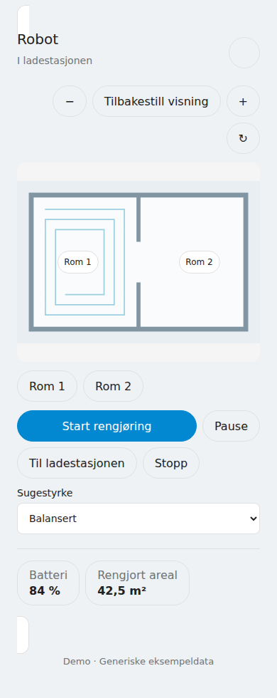

<p align="center"></p>

# Lovelace Roborock

Roborock dashboard with maps, room cleaning and dock controls for Home Assistant
Lovelace. It uses the official Roborock integration's entities and actions;
[Roborock Companion](https://github.com/mvheimburg/roborock-companion) 0.1.0+
adds a large desktop/tablet configuration panel and missing advanced map data.
The everyday card remains usable without the companion.

## Install

Requires HA Core **2026.11.1+** and the official Roborock integration. Add
`https://github.com/mvheimburg/lovelace-roborock` to HACS as **Dashboard** (HACS API
category `plugin`), install and add the **Roborock** card in the visual editor.
HACS needs a published release; for manual installation copy
`dist/lovelace-roborock.js` into `config/www/` and register
`/local/lovelace-roborock.js` as a JavaScript module resource.

```yaml
type: custom:roborock-card
entity: vacuum.robot
appearance: default
show_map: true
show_maintenance: true
```

The visual editor selects the vacuum, optional title, default/Bubble appearance,
visible sections and optional additional entity bindings. Related entities are
discovered through HA registries, including the dock. Restricted registry access
can be handled with explicit editor bindings. No entity-ID naming convention is
required. Unavailable readings remain unavailable; requests are not sent using
cached values after the robot changes or goes unavailable.

## Everyday use and configuration

Start, pause, stop, dock, locate (when supported), use enabled dock buttons,
choose rooms and change the existing suction/mop/dock
controls. Services retain their original numeric/enum values. A top-right 44px
cog opens the companion's large **Roborock** configuration panel; when the
companion is absent it opens the official integration's settings instead.

Without the companion, room information uses the public `roborock.get_maps`
action. Multiple floors without a verified active floor do not enable room
cleaning based on a guessed map. Room cleaning uses HA's public, map-qualified
`vacuum.clean_segments` action. The companion supplies calibrated map geometry
and its authenticated map image. Its advanced settings and geometry tools remain
subject to real model/firmware support. Advanced physical map writes are disabled
until an exact model/firmware profile has been verified; the
first release does not provide full LocalRock configuration parity.

Sensor buttons open the bundled recorder history with 6 h, 24 h and 7 d ranges,
related readings/units, pointer/keyboard inspection, gaps and legend more-info.
Static settings and schedule timestamps do not have numeric history because it
would not add useful measurement information. Cleaning-session records belong
to the companion's separate history page.

The rendered card and editor support English/Bokmål, nb variants, no and the
existing nn-to-Bokmål fallback, live HA language changes and regional formatting.
The static card-picker metadata has no HA language context and remains English.
User names are not translated or renamed. Theme colors come from HA; Bubble
requires no Bubble Card dependency.

## Local server

Use the unmodified upstream `local_roborock_server` behind the official HA
integration when avoiding the Roborock cloud. See the
[complete setup guide](docs/roborock-local-setup.nb.md). The card itself does not
remove the robot/library's original cloud dependencies, create a broker or
implement another robot state machine. A local connection indicator does not
prove the transport of every command.

## Development

```bash
npm ci
npx playwright install --with-deps chromium
npm test
npm run lint
npm run typecheck
npm run format:check
npm run build
```

Commit rebuilt `dist/` assets. The recorder library is vendored as a versioned
archive so a clean build needs no sibling checkout. UI/API source copies are
package-contained; see [API v1](docs/api-v1.md), DESIGN.md and UX-CONTRACT.md.
No owner's real home is used in demos or screenshots. Saros 20 Sonic hardware
commands require separate live validation; browser fixtures are not that proof.

Repository description and topics are configured. Maintenance command:

```bash
gh repo edit mvheimburg/lovelace-roborock --description "Roborock dashboard with maps, room cleaning and dock controls for Home Assistant Lovelace." --add-topic home-assistant --add-topic homeassistant --add-topic hacs --add-topic hacs-dashboard --add-topic lovelace --add-topic lovelace-card --add-topic lovelace-custom-card --add-topic roborock --add-topic robot-vacuum
```

## Preview


